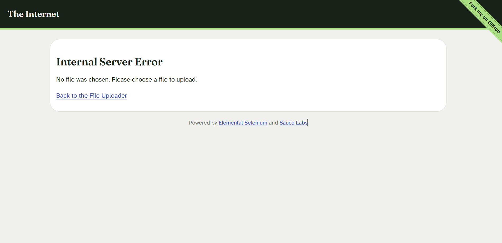

# Defect Report

## DEF-001: File Upload form returns a server error page when submitted without a file

| Field | Value                                                                           |
|-------|---------------------------------------------------------------------------------|
| **Application** | the-internet.herokuapp.com (public demo site)                                   |
| **Page** | File Upload - https://the-internet.herokuapp.com/upload                         |
| **Severity** | Low (no data loss; the user can go back and retry)                              |
| **Priority** | Low                                                                             |
| **Type** | Functional / error handling                                                     |
| **Status** | Open (not reported to the site owner; it is a demo site)                        |
| **Found by** | Automated test `FileUploadTest.submitWithoutFile_returnsServerError_knownIssue` |
| **Environment** | Windows, Chrome 155.0.8059.40, Selenium 4.25                                    |
| **Date found** | 2026, Oct 21st                                                                  |

### Summary
Clicking **Upload** without choosing a file sends the user to a page headed
"Internal Server Error". A missing file is a user input mistake, so the
application should answer with a validation message, not a server error.

### Steps to reproduce
1. Open https://the-internet.herokuapp.com/upload.
2. Do not choose a file.
3. Click **Upload**.

### Expected result
The user stays on the upload page and sees a clear validation message
(for example "Please choose a file to upload"). If the server rejects the
request, it responds with a client error (4xx), not a server error (5xx).

### Actual result
The browser shows a new page with the heading **"Internal Server Error"**
and the text **"No file was chosen. Please choose a file to upload."**
HTTP status of the response: 500.

### Impact
The message text is helpful, but it sits under a server-error heading, which
makes a normal user mistake look like an application failure. It would also
register as a server error in any monitoring that counts 5xx responses.

### Evidence

### Notes
- This site is a public demo built for practising test automation, so this
  behavior may be intentional. It is documented here as an exercise in
  writing a defect report, not as a claim that the site is broken.
- The automated test currently asserts the behavior as it is today. If the
  site is ever fixed, that test will fail and should be updated to expect the
  validation message instead.
